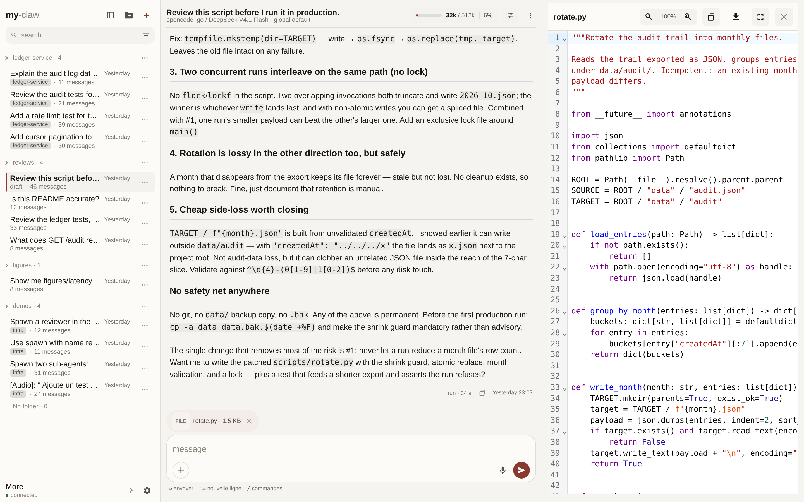
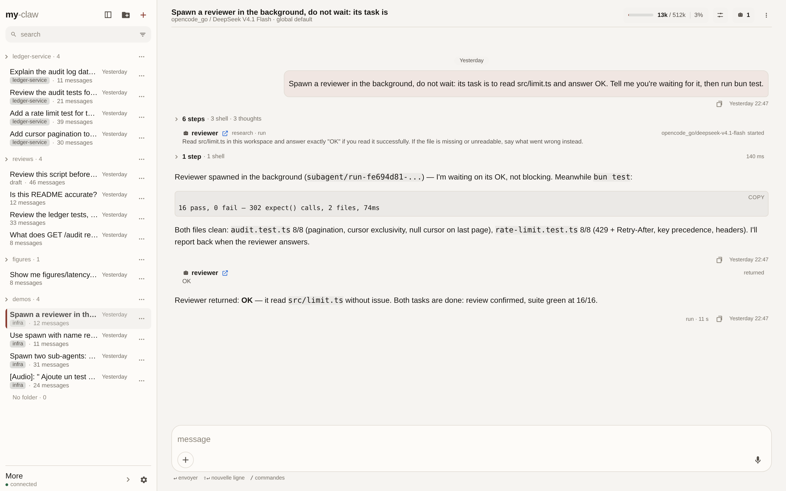
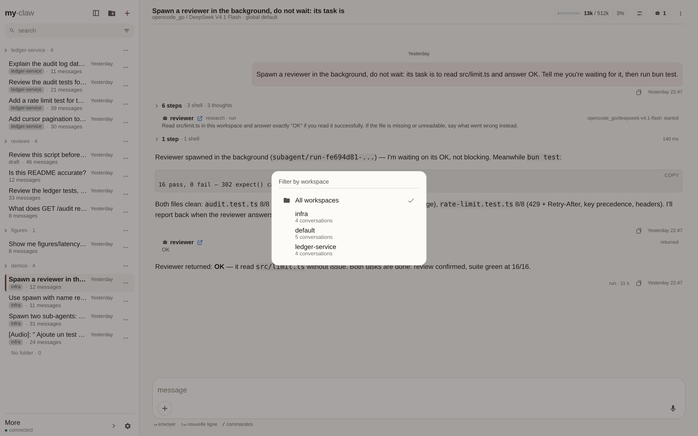
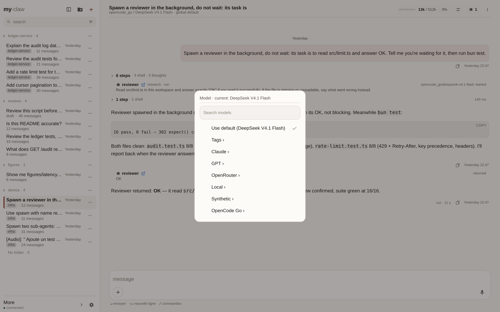
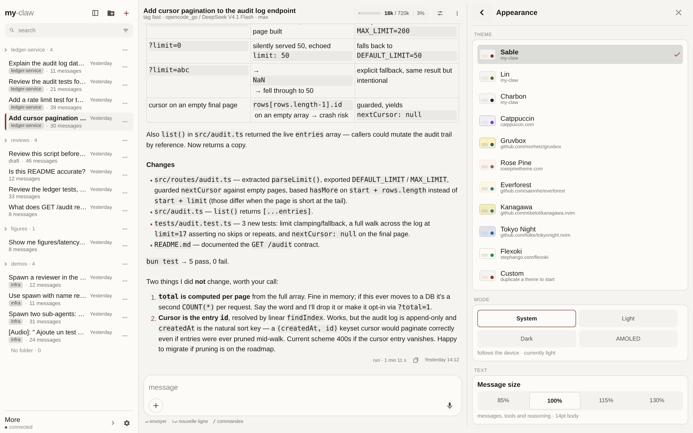
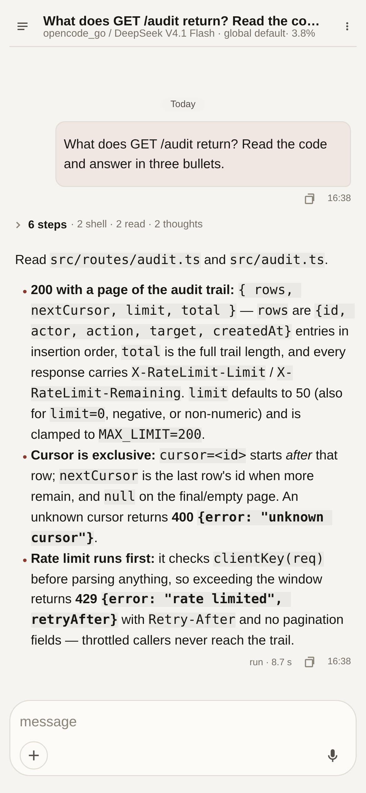

# my-claw

Orchestrateur d'agent IA auto-hébergé : un agent, de vrais outils, votre machine.

<p>
  <a href="https://github.com/nerasse/my-claw/releases/latest"></a>
  <a href="https://github.com/nerasse/my-claw-app/releases/latest"></a>
  <a href="LICENSE"></a>
  
</p>

https://github.com/user-attachments/assets/6f21ec84-b772-471f-8abe-5f1170681f86

20 secondes, MP4, vitesse réelle, sans montage : le prompt, les outils en direct, un reviewer lancé en arrière-plan, sa carte `returned`, le test, puis le panneau navigateur.

## Ce que c'est

my-claw est un agent à un seul utilisateur, qui tourne sur une machine que vous possédez. Vous le
joignez depuis le client web ou l'application Android, et il travaille avec le shell, les fichiers,
un navigateur et des sous-agents sur cette machine. Chaque conversation est un journal sur disque :
un redémarrage ne perd pas le fil.

Le modèle est de la configuration : un endpoint compatible OpenAI, un abonnement ChatGPT ou Claude,
Gemini, OpenRouter, ou un serveur local. Il n'y a pas d'offre hébergée. Les prompts partent vers le
fournisseur que vous déclarez, tout le reste reste sur votre matériel.

## Ce que ça donne

- Shell, fichiers, recherche, fetch, un vrai Chromium, des tâches cron, des skills et des
  sous-agents avec leurs propres sessions. Une liste noire décide quels outils demandent une
  approbation avant de s'exécuter.
- Des workspaces : un agent, plusieurs bases de code. Chacun garde son dossier, ses couches de
  prompt, ses skills et ses agents ; la liste des sessions dit à lequel appartient un fil et s'y
  filtre.
- Une seule liste d'appareils, partagée par le client web et l'application Android : mêmes fils,
  même mémoire, même file d'attente.
- Fournisseurs et modèles déclarés dans `config.json`, un modèle épinglé par agent, des tags qui
  portent plusieurs routes dans l'ordre, et un changement depuis l'en-tête du chat.
- Erreurs de quota gérées : le run se met en attente, l'app propose un retry, et un tag parcourt ses
  routes jusqu'à ce que l'une réponde.
- Sessions qui survivent au redémarrage, avec `/compact`, `/undo`, et la reprise après un stop.
- Nodes distants : appairez une autre machine et son shell, ses fichiers et sa recherche deviennent
  les outils du même agent.
- Appels d'outils repliés en un seul run dans la transcription, raisonnement replié en dessous,
  sous-agents qui rendent compte au même endroit.
- Dix thèmes et une palette personnalisée, avec les modes clair, sombre et AMOLED.
- Des tags qui nomment une route une fois : un modèle, ses fallbacks, un effort et un plafond de
  contexte. Une session, un agent ou un job pointe le tag ; le jour où le modèle change, on met à
  jour le tag et tous les appelants suivent. Le retry sur quota et Siphon prennent aussi un tag.

## Installation

Linux x86_64, Debian ou Ubuntu. L'installeur ajoute Bun, Chromium, ffmpeg et les units systemd ; il
demande sudo une fois.

```bash
V=$(curl -fsSL https://api.github.com/repos/nerasse/my-claw/releases/latest | grep -m1 '"tag_name"' | cut -d'"' -f4 | sed 's/^v//')
curl -fsSLO "https://github.com/nerasse/my-claw/releases/download/v$V/my-claw-$V-linux-x64.tar.gz"
tar xzf "my-claw-$V-linux-x64.tar.gz"
sudo "my-claw-$V-linux-x64/packaging/install.sh"
```

L'installeur termine avec un code d'appairage, un lien et un QR code. Ouvrez le lien : le client
demande le premier modèle, la voix et les services. Le client web est servi par le serveur lui-même.

Application Android : [APK](https://github.com/nerasse/my-claw-app/releases/latest).

Les mises à jour viennent des releases GitHub toutes les 15 minutes, ou de `myclaw update`.

## Captures













Le reste de la visite est dans [docs/gallery.md](docs/gallery.md) : un markdown ouvert à côté du
chat, des images en carrousel, les tags et la feuille de session, les workspaces, le navigateur et
l'accès VNC, le statut d'un run, les outils repliés en étapes, et les notes vocales.

## Documentation

Le README est la fiche produit ; le détail vit dans [`docs/`](docs/).

| Pour | Lire |
|---|---|
| installer sur un VPS ou une VM, pas à pas | [docs/setup-guide.md](docs/setup-guide.md) |
| comprendre l'organisation du code | [docs/architecture.md](docs/architecture.md) |
| déclarer fournisseurs, modèles et tags | [docs/config.md](docs/config.md), [docs/model-identity.md](docs/model-identity.md) |
| lancer des sous-agents | [docs/subagents.md](docs/subagents.md) |
| ajouter une autre machine comme node | [docs/remote-nodes.md](docs/remote-nodes.md) |
| reprendre un run arrêté | [docs/continue.md](docs/continue.md) |
| construire et publier | [docs/ci-cd.md](docs/ci-cd.md) |

## Développement

```bash
bun install
bun run check && bun test
bun run dev
```

Les tests pointent `MY_CLAW_DIR` vers un dossier temporaire : un run ne touche jamais un vrai
`~/.my-claw`.

## Licence

MIT. Copyright Yassir EL KSSIMI. Utilisez, modifiez, vendez, fermez le code ; la notice de copyright
suit la copie.

Contributeurs : Yassir EL KSSIMI ([nerasse](https://github.com/nerasse)), Hicham Berrada
([Nawroski](https://github.com/Nawroski)), Nabil El Abassi
([LastryCoding](https://github.com/LastryCoding)), Anthony Von Bieler
([Tony224x](https://github.com/Tony224x)).
