# Gallery

Real screenshots of the current UI, one screen per image, taken on a demo install with fake data.
Every image keeps the conversation list on the left, so the folders and the thread stay in view.

[Watch the recording](assets/readme/demo.mp4): 20 seconds, real speed, no montage. The prompt is
sent, the tools stream in, a reviewer is spawned in the background, its `returned` card comes back
with `OK`, the test run lands, then the session is pointed at the browser panel.

## A run, folded into steps

Three shells and three thoughts fold under one line; the reviewer appears where it was spawned, and
its return is its own card. The threads on the left are filed in folders.

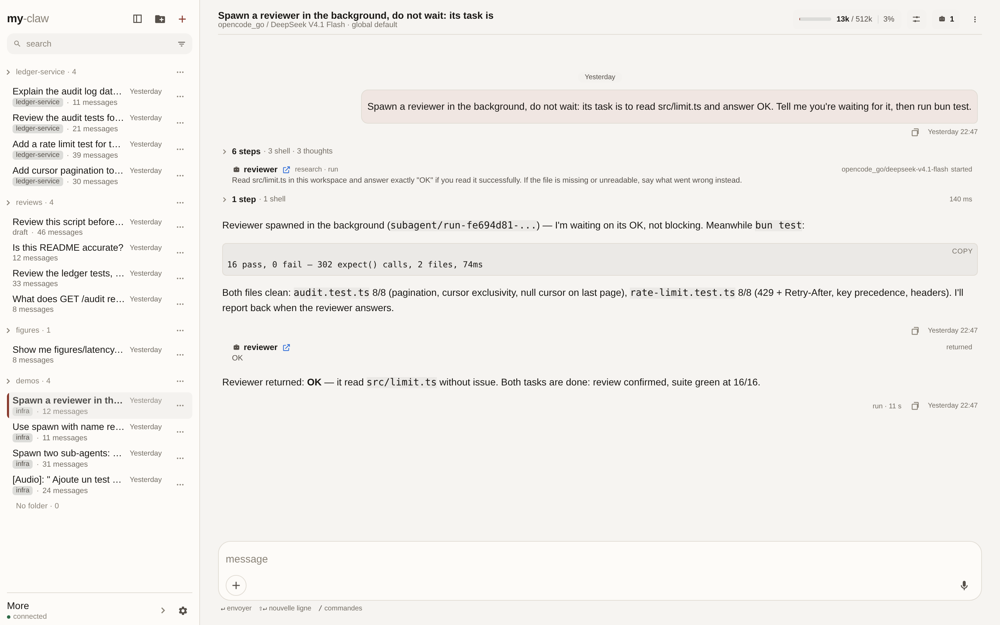

## Every provider, one picker

Claude, GPT, OpenRouter, the local LiteLLM and llama.cpp models, Synthetic, OpenCode Go, plus the
tags that name a whole route.

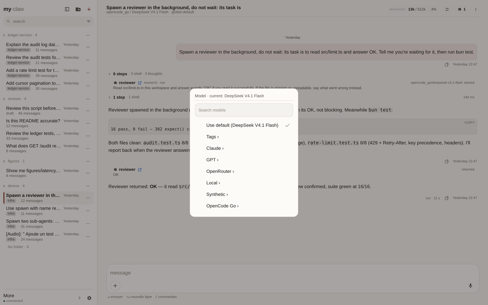

## Tags, not model names

A tag holds a model, its fallbacks, an effort and a context cap. Point a session, an agent or a job
at the tag, then update the tag when a provider changes its line-up and every caller follows.

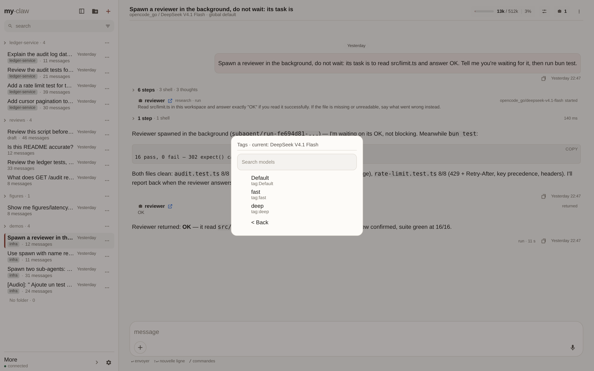

## A markdown file beside the chat

The same gesture opens any attachment: here a README rendered, not its source, with the answer that
reads it still on screen.

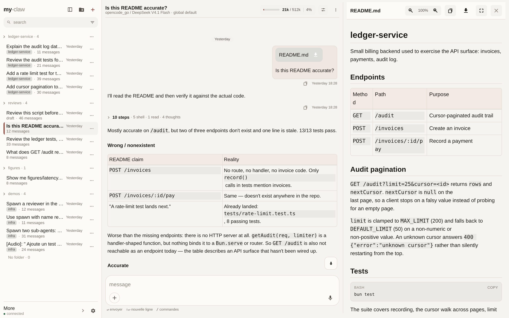

## A Python file beside the chat

Coloured by the editor's grammar, line numbers, a download and a full-screen button.

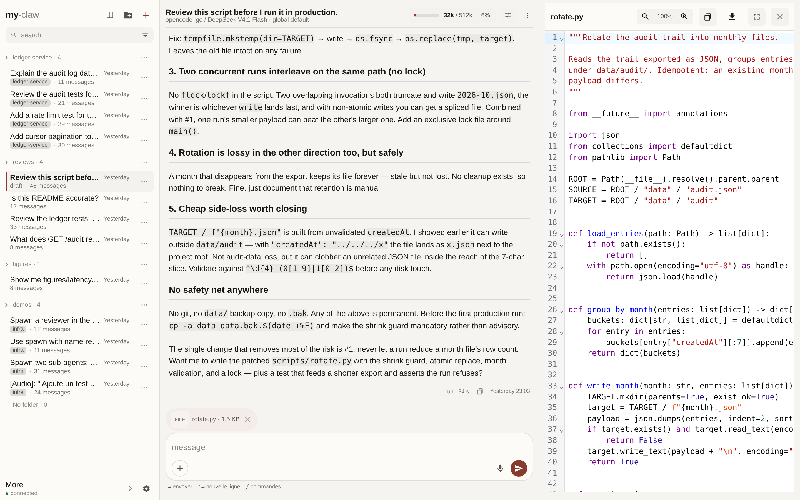

## The prompt, layer by layer

Core, SOUL, AGENTS, USER, the skills, the runtime: what the model reads before the first token, and
what can be switched off per session.

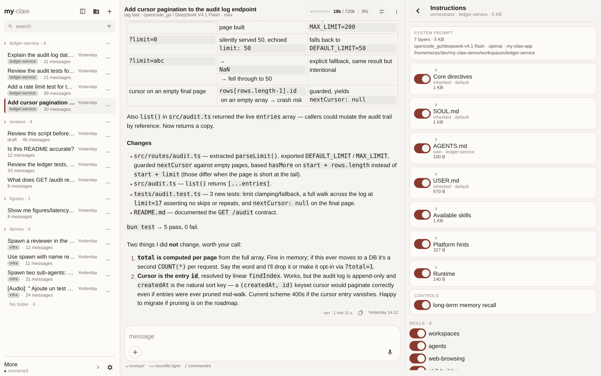

## Ten themes, three modes

Sable, Lin, Charbon, Catppuccin, Gruvbox, Rose Pine, Everforest, Kanagawa, Tokyo Night, Flexoki, and
a custom palette. Light, dark, AMOLED black, or follow the device.

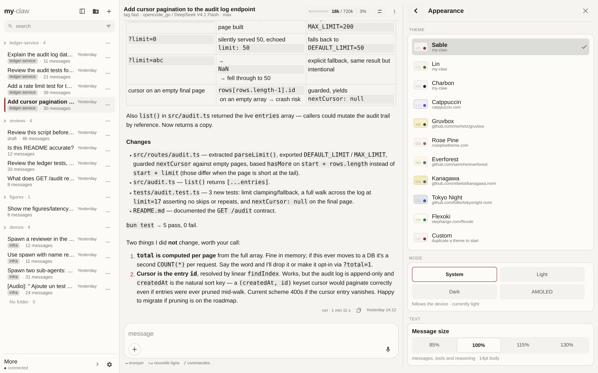

## The session menu

Retry when the quota returns, Siphon, instructions, files, folders, change workspace, status,
transcript, archive. Everything the thread needs, one sheet.

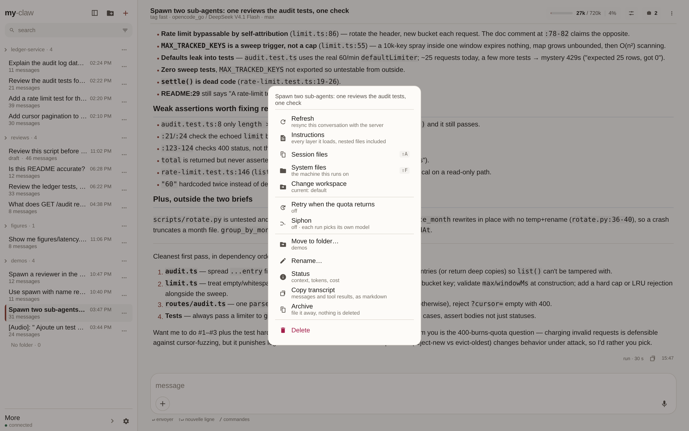

## Workspaces

One machine, several codebases: each workspace keeps its own files, prompt layers, skills and
agents. The filter narrows the list to one of them, and every row says which one it belongs to.

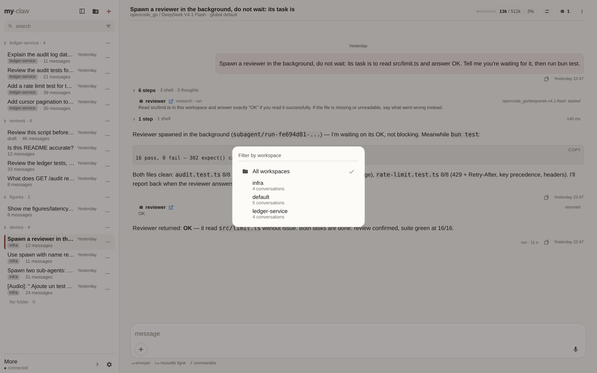

The default workspace holds the memory and the conversations; named ones point at a directory. Open
one to edit its instructions, rename it or repoint it.

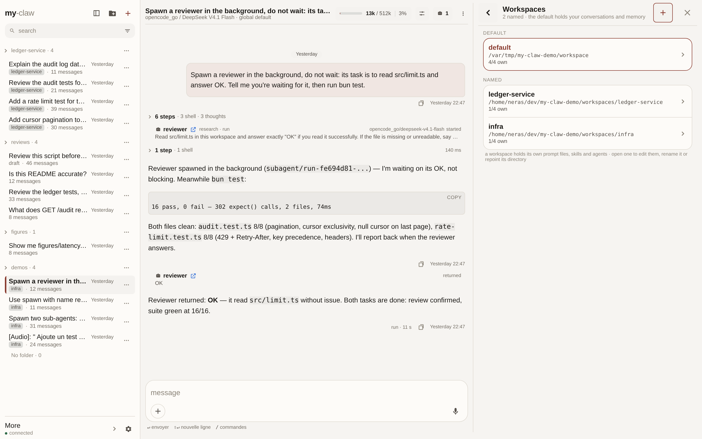

## Status, with the sub-agents

Context against the cap, what the run cost, the cached share, and one row per model in play,
sub-agents included.

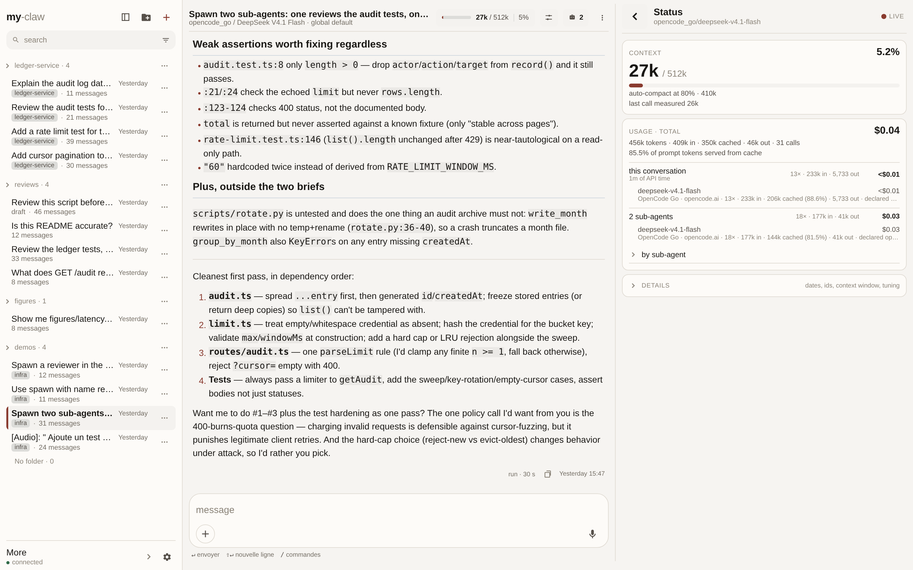

## Browser

The windows the agent works in, with their tabs, live next to the conversation. VNC is there for a
client that wants the real thing.

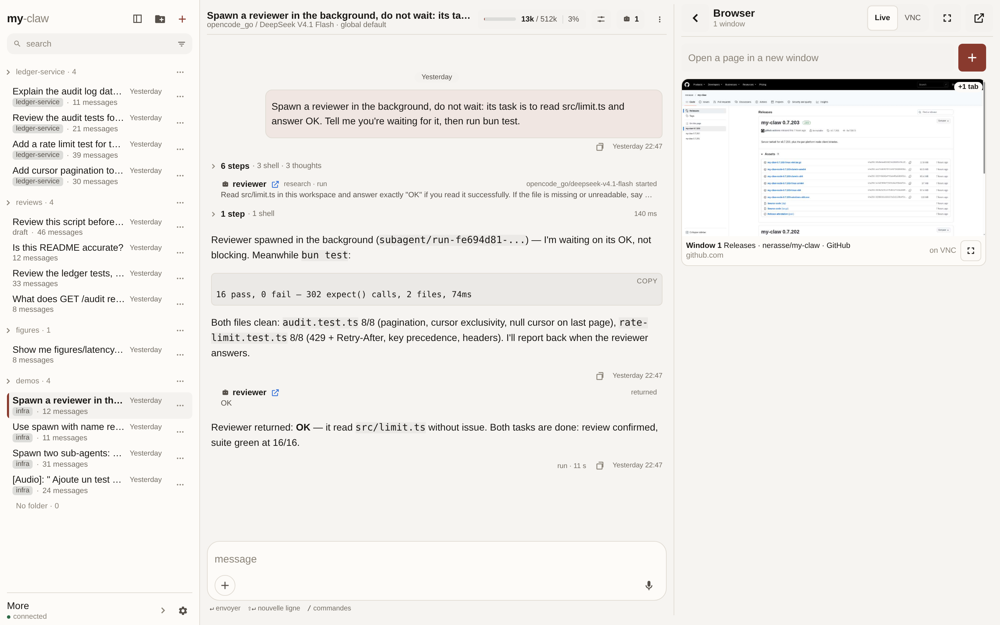

## Pictures in the chat

Several images in one answer open as a carousel with its own counter and arrows.

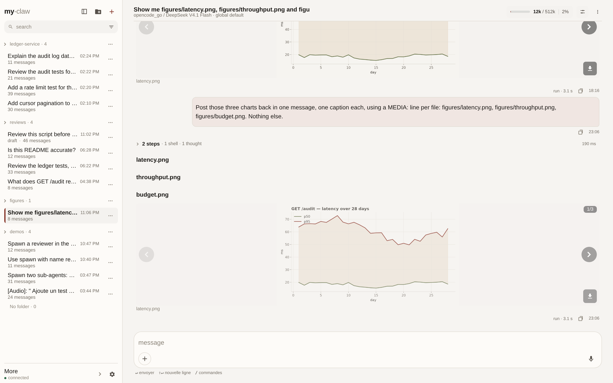

## A voice note, transcribed

The player, the transcript under it, and the answer in the same thread.

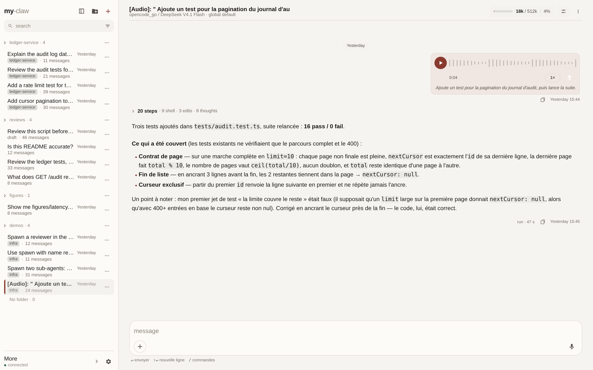

## On a phone

One header line carries the model, the provider, the effort and the context; the composer stays at
the bottom.

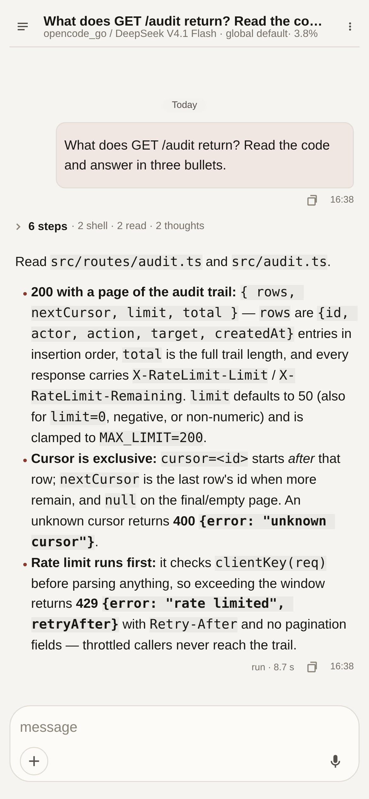
