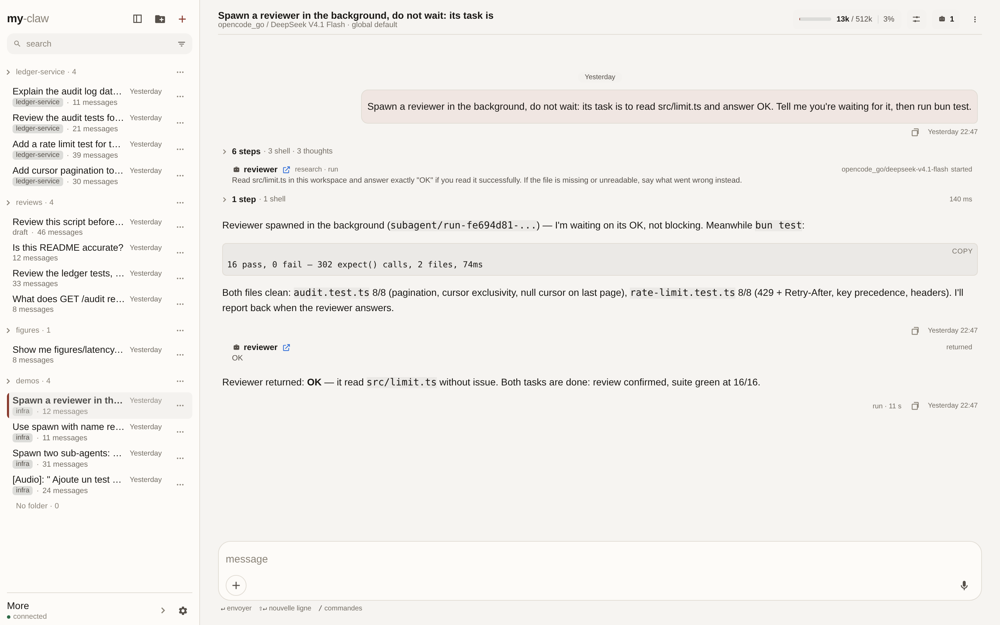
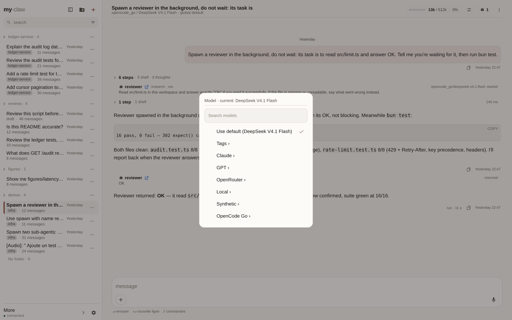
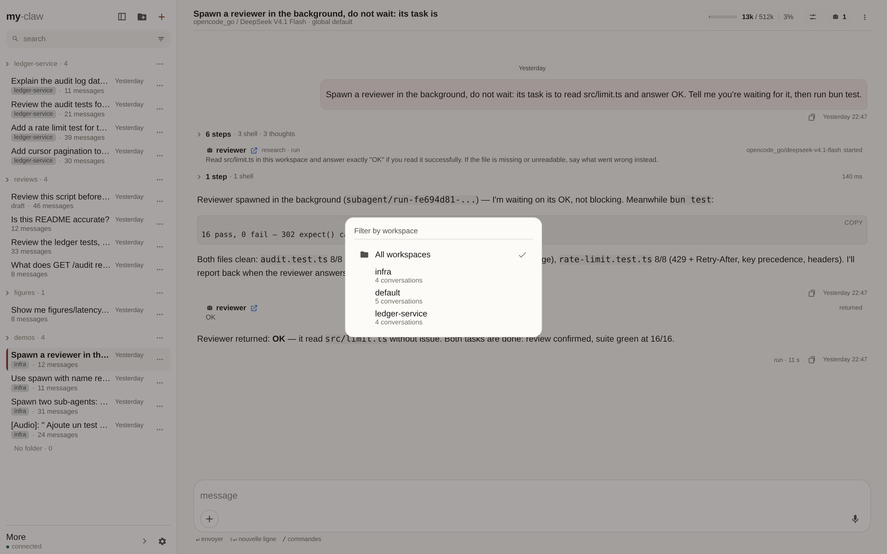

# my-claw

Orchestrateur d'agent IA auto-hébergé : un agent, de vrais outils, votre machine.

Vous le joignez depuis le client web ou l'application Android, et il travaille avec le shell, les
fichiers, un vrai Chromium et des sous-agents sur la machine que vous possédez. Chaque conversation
est un journal sur disque, donc un redémarrage ne perd pas le fil.

Le modèle est de la configuration : un endpoint compatible OpenAI, un abonnement ChatGPT ou Claude,
Gemini, OpenRouter, ou un serveur local. Il n'y a pas d'offre hébergée.

<video controls muted loop playsinline src="assets/readme/demo.mp4"></video>

## Commencer

- [Installer sur un VPS ou une VM](setup-guide.md), pas à pas, avec les vérifications.
- [Configuration](config.md) : le fichier, les sections, les secrets.
- [Modèles et fournisseurs](model-identity.md) : ce que déclare un modèle, et comment il est résolu.

## Comprendre

- [Architecture](architecture.md) : les modules, les flux, les décisions.
- [Sessions](https://github.com/nerasse/my-claw/blob/main/docs/session-log.md) : le journal comme source unique de l'historique.
- [Sous-agents](subagents.md) : sessions persistantes, file d'attente, visibilité.
- [Nodes distants](remote-nodes.md) : une autre machine, ses outils dans le même agent.

## Exploiter

- [Mises à jour](auto-update.md) : la source de release, le timer, le retour arrière.
- [CI/CD](ci-cd.md) : ce que construit un tag, et ce qu'il publie.
- [Approbations](tool-approvals.md) : ce qui demande un accord, et où il se donne.

## En images

La suite est dans [la galerie](https://github.com/nerasse/my-claw/blob/main/docs/gallery.md) : un
markdown ouvert à côté du chat, les thèmes, le navigateur, le statut d'un run, les notes vocales.
