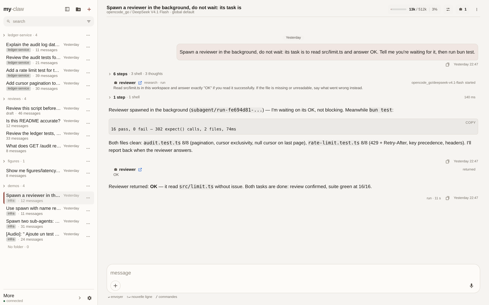
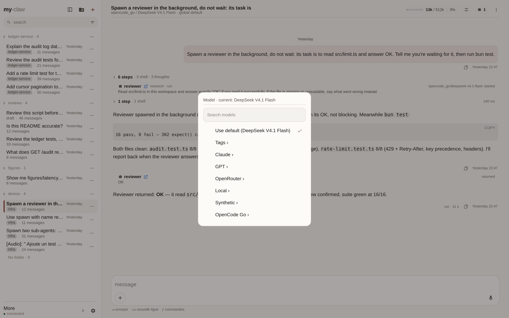
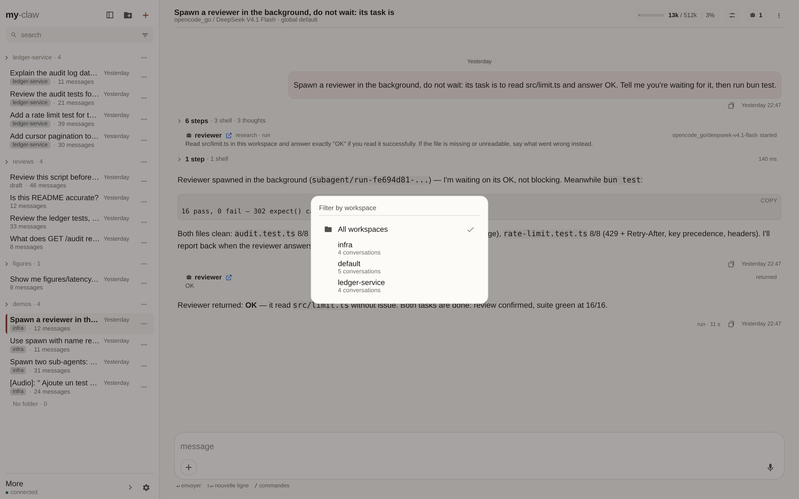

# my-claw

Self-hosted AI agent orchestrator: one agent, real tools, your machine.

You reach it from the web client or the Android app, and it works with the shell, the files, a real
Chromium and sub-agents on the machine you own. Every conversation is a log on disk, so a restart
does not lose the thread.

The model is configuration: an OpenAI-compatible endpoint, a ChatGPT or Claude subscription, Gemini,
OpenRouter, or a local server. There is no hosted offering.

<video controls muted loop playsinline src="assets/readme/demo.mp4"></video>

## Getting started

- [Install on a VPS or a VM](setup-guide.md), step by step, with the checks.
- [Configuration](config.md): the file, the sections, the secrets.
- [Models and providers](model-identity.md): what a model declares, and how it is resolved.

## Understanding

- [Architecture](architecture.md): the modules, the flows, the decisions.
- [Sessions](https://github.com/nerasse/my-claw/blob/main/docs/session-log.md): the log as the single source of the history.
- [Sub-agents](subagents.md): persistent sessions, queueing, visibility.
- [Remote nodes](remote-nodes.md): another machine, its tools in the same agent.

## Operating

- [Updates](auto-update.md): the release source, the timer, the rollback.
- [CI/CD](ci-cd.md): what a tag builds, and what it publishes.
- [Approvals](tool-approvals.md): what requires approval, and where it is given.

## In pictures

The rest is in [the gallery](https://github.com/nerasse/my-claw/blob/main/docs/gallery.md): a
markdown file opened next to the chat, the themes, the browser, the status of a run, voice notes.
